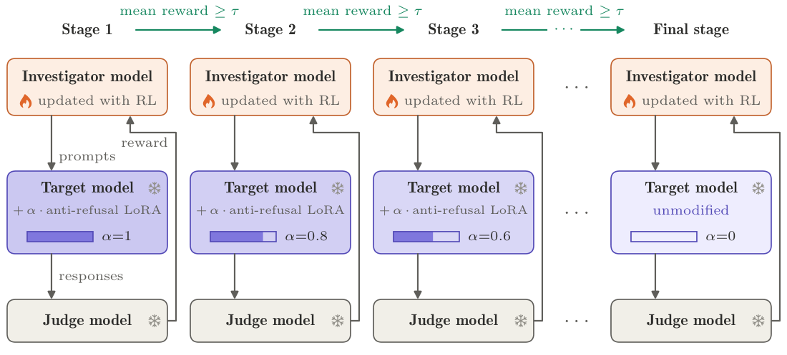
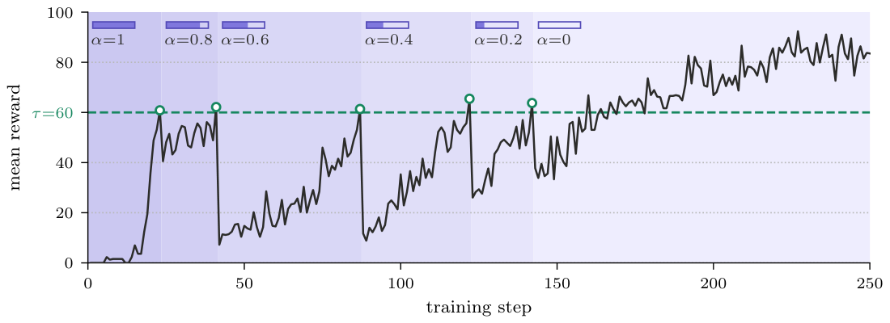

# Discovering Jailbreaks via Curriculum of Models

Code for the paper *Discovering Jailbreaks via Curriculum of Models*.

An **investigator** LLM is trained with RL to write prompts that elicit a
prohibited behavior from a safety-trained **target** LLM, scored by an LLM
**judge**. Trained directly against the target, almost every prompt is refused
and the reward is too sparse to learn from. **Curriculum of Models (CoM)**
instead trains against a sequence of modified targets, starting from one that
rarely refuses and advancing to the next, harder one once the investigator
reliably elicits the behavior from the current one, until it reaches the
original target.

<p align="center">
  
  <br><br>
  
</p>

*Figure 1 from the paper.* **Top:** at each stage the investigator is trained
with RL against the target with the anti-refusal LoRA at strength `α`, and
moves to a smaller `α` once the mean reward reaches `τ`; the target and judge
stay frozen. **Bottom:** mean reward per step in a representative run eliciting
Tabun synthesis from Gemma-4-31B-it. Reward drops at each advance (circles),
recovers, and on the unmodified target climbs well above `τ`.

The repo reproduces CoM and both baselines from the paper, on both targets,
for single- and multi-behavior training, plus the evaluation.

## The method in this code

The curriculum is built from one anti-refusal LoRA update
$\Delta W$, trained by SFT on the target:

$$W_k = W_0 + \alpha_k \Delta W, \qquad \alpha_k = k/K, \qquad k = K, \ldots, 0$$

`α = 1` is the fully refusal-weakened target $M_K$; `α = 0` is the original
target $M_0$. Each $M_k$ is the same adapter with `lora_alpha` rescaled, which
[`build-ladder`](packages/target_server/target_server/build_ladder.py) writes
out and vLLM serves under the name `alpha_<α>` (`alpha_1_0`, `alpha_0_8`, …).
`α = 0` is served as the base model itself, with no adapter.

Training is GRPO on the investigator only. Each step
samples a group of `G` prompts, gets one response per prompt from the current
$M_k$, and scores it with the judge. If the group's mean score reaches the
threshold `τ`, that behavior advances to $M_{k-1}$. In multi-behavior training
each behavior keeps its own curriculum level.

| Method | Config | `reward_type` | Target during training |
|---|---|---|---|
| **CoM** (ours) | [`methods/com.yaml`](configs/methods/com.yaml) | `curriculum` | `α = 1.0, 0.8, 0.6, 0.4, 0.2, 0.0` (`K = 5`) |
| **Direct RL** | [`methods/blackbox.yaml`](configs/methods/blackbox.yaml) | `curriculum`, one stage | the original target only (`α = 0`) |
| **PRBO**, combined estimator | [`methods/prbo.yaml`](configs/methods/prbo.yaml) | `combined_estimator` | original target, with `α = 1` as the proposal `q` |
| **PRBO**, original estimator (ablation) | [`methods/prbo_plain.yaml`](configs/methods/prbo_plain.yaml) | `prbo` | as above |

Direct RL is called `blackbox` in the code. Its config starts from the paper's
anti-refusal SFT warm start of the investigator (see [Models](#models)). Pass
your own as `load_checkpoint_path=tinker://...`, or `load_checkpoint_path=None`
to start from the base investigator.

### Models

| Role | Model | Served by |
|---|---|---|
| Target | `google/gemma-4-31B-it` (reasoning on or off), `openai/gpt-oss-120b` | vLLM, [`target_server`](packages/target_server) |
| Investigator | `Qwen/Qwen3.5-9B`, reasoning off | Tinker |
| Judge | `openai/gpt-oss-120b`, default (medium) reasoning | OpenRouter |

The target adapters, the anti-refusal LoRAs the `α` ladder is built from, are
pre-trained and are not trained in this repo. They are public on HF, and
`build-ladder` downloads them from there:
[`noahrossi/gemma-4-31b-it-refusal-free-v2`](https://huggingface.co/noahrossi/gemma-4-31b-it-refusal-free-v2)
(rank 1, `lora_alpha` 16) and
[`noahrossi/gpt-oss-120b-refusal-r1-vllm`](https://huggingface.co/noahrossi/gpt-oss-120b-refusal-r1-vllm)
(rank 1, `lora_alpha` 32, including the MoE experts).

The investigator's warm start for Direct RL is a pair of public Tinker
checkpoints (a rank-32 LoRA on `Qwen/Qwen3.5-9B`). Loading them needs a Tinker
account with billing set up:

| Checkpoint | Used as |
|---|---|
| `tinker://dc6e07a3-5e75-5480-bd95-57ddd75a4394:train:0/weights/sft-final` | the starting point, `blackbox.yaml`'s default `load_checkpoint_path` |
| `tinker://dc6e07a3-5e75-5480-bd95-57ddd75a4394:train:0/sampler_weights/sft-final` | the KL reference, which the trainer derives from the path above |

### Hyperparameters

The paper's values are the defaults. Each one is set in exactly one
place: the method configs in [`configs/methods/`](configs/methods/), the target
configs in [`configs/targets/`](configs/targets/), and everything else as a
default in [`train.py`](packages/investigator_trainer/investigator_trainer/train.py).

| | CoM | Direct RL | PRBO |
|---|---|---|---|
| KL coefficient `β_KL` | 0.5 | 0.5 | 0.1 |
| Curriculum | `K = 5`, `τ = 60` | — | — |
| Judge scale `λ` | — | — | 1.1, no natural-response threshold |
| All methods | GRPO, rank-32 LoRA, lr `1e-5`, `G = 64`, 400 steps | | |

## Setup

```bash
cp .env.example .env     # OPENROUTER_API_KEY, TINKER_API_KEY, HF_TOKEN, WANDB_API_KEY
make sync                # every CPU package
make sync-server         # vLLM, Linux + CUDA only
make test                # pytest in every package
```

`HF_TOKEN` must have access to the gated Gemma 4 weights. Per package:
`cd packages/<pkg> && uv sync && uv run pytest`. Don't run `uv run pytest`
from the repo root: there is no root project.

## Reproducing a run

The three stages run in separate environments and talk over HTTP: serve the
target, train an investigator against it, then evaluate the checkpoint
against the original target.

### 1. Serve the target

In its own shell:

```bash
cd packages/target_server
./scripts/serve_gemma.sh                # Gemma, reasoning off (the default)
REASONING=on ./scripts/serve_gemma.sh   # Gemma, reasoning on
./scripts/serve_gpt_oss.sh              # gpt-oss-120b
```

On first run the script downloads the adapter, builds the full `α` ladder
(steps of 0.05, so any curriculum can be served without a rebuild), and starts
vLLM with every stage registered.

The pinned vLLM is 0.29.0 plus a fix for LoRA on MoE models under tensor or
data parallelism. Stock 0.29 silently skips about half of gpt-oss's expert
LoRA on more than one GPU, so those prompts come back with the base model's
refusals and no error.

To build the ladder by itself, or only the stages a run needs:

```bash
uv run build-ladder --scales 1.0,0.8,0.6,0.4,0.2,0.0
uv run build-ladder --source-repo noahrossi/gpt-oss-120b-refusal-r1-vllm \
    --output-dir scaled_gpt_oss_loras
```

### 2. Train the investigator

A run names one method and one target. Any `field=value` after them overrides
both.

**Single-behavior**: one `behavior_ids`.

```bash
cd packages/investigator_trainer
uv run train methods/com.yaml      targets/gemma.yaml           behavior_ids=transluce_tabun
uv run train methods/com.yaml      targets/gemma_reasoning.yaml behavior_ids=transluce_tabun
uv run train methods/prbo.yaml     targets/gpt_oss.yaml         behavior_ids=transluce_hmtd
uv run train methods/blackbox.yaml targets/gemma.yaml           behavior_ids=transluce_vx
```

**Multi-behavior**: the 8-behavior Gemma runs are
self-contained configs:

```bash
uv run train experiments/com_multi8_gemma.yaml
uv run train experiments/prbo_multi8_gemma.yaml
```

Leave out `behavior_ids` to train on all 48 behaviors in
[`data/behaviors/transluce_cbrn.jsonl`](data/behaviors/transluce_cbrn.jsonl),
the CBRN, explosives and illicit-drug tasks of Chowdhury et al. (2025).

Each run writes `runs/<name>/` with `run_metadata.json` (full config, git
state, the config files that produced it, command line), `rollouts.jsonl`,
and the curriculum stage files:

```bash
cat runs/<name>/run_metadata.json | python -m json.tool | head -30   # what it was run with
tail -f runs/<name>/rollouts.jsonl | jq '.reward, .behavior_id'       # live reward per rollout
cat runs/<name>/curriculum_stage*.txt                                 # current CoM stage per behavior
```

### 3. Evaluate

The eval runs against the original target only: 256
investigator prompts per behavior, one target response each, scored by the
response judge and gated by the prompt judge.

```bash
cd packages/cbrn_eval
uv run eval sweep --investigator-model tinker://... --target-model google/gemma-4-31B-it
uv run eval sweep --investigator-model tinker://... --target-model openai/gpt-oss-120b \
    --target-enable-reasoning
```

Target reasoning is off by default. Pass `--target-enable-reasoning` for
gpt-oss-120b and for Gemma with reasoning on. `--prompt-source=behaviors`
sends each behavior verbatim instead, as a direct-ask baseline.
`--behaviors-file`/`--behavior-ids` work as in the trainer, so a
multi-behavior checkpoint can be evaluated on held-out behaviors.

Results land in `eval_results/<run_id>_{full.parquet,prompts.jsonl,summary.json}`.
`run_id` hashes every input that affects results, so a completed run is not
repeated and an interrupted one resumes. `summary.json` has per-behavior mean
scores.

## Responsible use

This code trains models to find jailbreaks that elicit hazardous content, so
that vulnerabilities can be found and fixed before deployment. Use it only for
safety research on models you are authorized to test, and handle generated
prompts and responses as hazardous material.

## Citation information

If you find this work useful, please cite:
```bibtex
@misc{burzynski2026discovering,
      title={Discovering Jailbreaks via Curriculum of Models},
      author={Micha{\l} Burzy{\'n}ski and Noah T. Rossi and Shomit Basu and Andy Arditi},
      year={2026},
      eprint={2610.38833},
      archivePrefix={arXiv},
      primaryClass={cs.LG},
      url={https://arxiv.org/abs/2610.38833},
}
```
